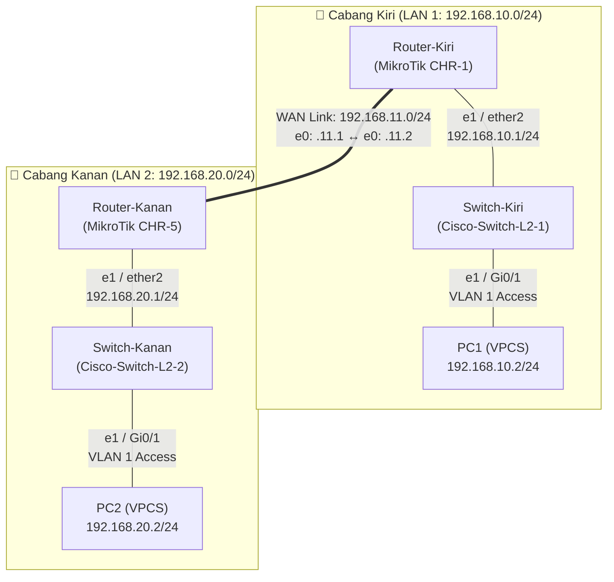

<div align="center">

# 🌐 Multi-Vendor Inter-Branch Network

### GNS3 · 2x MikroTik CHR · 2x Cisco IOSvL2 · Static Routing · VMware & VirtualBox Integration


<br>


<sub>Full multi-vendor topology running on GNS3 Local Server & Remote GNS3 VM</sub>

</div>

---

## 📑 Table of Contents

[Overview](#-overview) · [Highlights](#-highlights) · [Topology](#%EF%B8%8F-topology) · [LAN & Subnet Plan](#-lan--subnet-plan) · [WAN Link](#-wan-link) · [Config Guide](#%EF%B8%8F-configuration-guide) · [Configs](#-full-device-configs) · [Testing](#-verification--testing) · [Troubleshooting](#-gns3-troubleshooting-notes) · [Structure](#-repository-structure)

---

## 📖 Overview

Proyek ini mensimulasikan arsitektur jaringan **Inter-Branch (LAN-to-LAN)** yang menghubungkan dua cabang kantor (**Cabang Kiri** dan **Cabang Kanan**) menggunakan kombinasi perangkat **Multi-Vendor** di dalam emulator **GNS3**:

- **Cabang Kiri (LAN 1):** Menggunakan `MikroTik CHR-1` sebagai *gateway router* dan `Cisco-Switch-L2-1` sebagai *access switch* untuk melayani segmen jaringan `192.168.10.0/24` (`PC1`).
- **Cabang Kanan (LAN 2):** Menggunakan `MikroTik CHR-5` sebagai *gateway router* dan `Cisco-Switch-L2-2` sebagai *access switch* untuk melayani segmen jaringan `192.168.20.0/24` (`PC2`).

Kedua router MikroTik dihubungkan melalui jalur **Point-to-Point WAN (`192.168.11.0/24`)** dan saling bertukar informasi rute jaringan menggunakan metode **Static Routing**, memungkinkan komunikasi penuh (*end-to-end*) antar klien di kedua cabang.

## ✨ Highlights

| | | |
|:---:|:---:|:---:|
| 🔀 **Multi-Vendor Integration**<br>MikroTik RouterOS CHR + Cisco IOSvL2 | 🛣️ **Static Routing**<br>pertukaran rute presisi antar cabang | 🖧 **Hybrid Hypervisor**<br>VMware (GNS3 VM) + VirtualBox Linked Clone |
| 🧱 **Cisco Layer 2 Switching**<br>real `vios_l2` QEMU appliance dengan KVM | ⚡ **KVM Hardware Acceleration**<br>performa tinggi & *low CPU usage* di GNS3 VM | 💻 **VPCS End-Devices**<br>simulasi klien ringan untuk uji *ping* & *trace* |
| 🔗 **Point-to-Point WAN**<br>interkoneksi tulang punggung `192.168.11.0/24` | 🛠️ **Port Mapping Standard**<br>konversi akurat port GNS3 (`e0`) ke OS (`ether1`) | 📘 **PDF Documentation**<br>dilengkapi modul panduan praktikum siap cetak |

---

## 🗺️ Topology

### GNS3 Workspace View


### Logical View (Mermaid Diagram)



### Zones & Hardware Specification

| Branch | Zone Role | Router (Layer 3) | Switch (Layer 2) | End Devices | Execution Server |
|:------:|-----------|------------------|------------------|-------------|------------------|
| **Cabang Kiri** | LAN 1 | `MikroTik_CHR-1` (`Router-Kiri`) | `Cisco-Switch-L2-1` (`Switch-Kiri`) | `PC1` (VPCS) | VirtualBox & GNS3 VM |
| **Cabang Kanan** | LAN 2 | `MikroTik_CHR-5` (`Router-Kanan`) | `Cisco-Switch-L2-2` (`Switch-Kanan`) | `PC2` (VPCS) | VirtualBox & GNS3 VM |

---

## 📋 LAN & Subnet Plan

| Color | Branch | Zone Name | VLAN | Subnet | Gateway | End Devices |
|:-----:|:------:|-----------|:----:|--------|---------|-------------|
| 🟦 | Cabang Kiri | **LAN 1** | **1 (Default)** | `192.168.10.0/24` | `192.168.10.1` | `PC1` (`192.168.10.2`) |
| 🟩 | Cabang Kanan | **LAN 2** | **1 (Default)** | `192.168.20.0/24` | `192.168.20.1` | `PC2` (`192.168.20.2`) |

## 🔗 WAN Link

| Link | Subnet | Side 1 (Cabang Kiri) | IP Address | Side 2 (Cabang Kanan) | IP Address |
|------|--------|----------------------|------------|-----------------------|------------|
| **Router-Kiri ↔ Router-Kanan** | `192.168.11.0/24` | `MikroTik_CHR-1` (`e0` / `ether1`) | `192.168.11.1/24` | `MikroTik_CHR-5` (`e0` / `ether1`) | `192.168.11.2/24` |

---

## ⚙️ Technologies & Concepts

| Technology | Implementation in this Lab |
|------------|----------------------------|
| **MikroTik RouterOS CLI** | Konfigurasi identitas router, pengalamatan IP per-interface, dan tabel routing statis |
| **Cisco IOSvL2 Switching** | Konfigurasi *access port* Layer 2 (`Gi0/0 - 1`) pada VLAN 1 dan penyimpanan NVRAM |
| **Static Routing** | Penentuan jalur manual menuju subnet tujuan (`dst-address`) melewati IP *next-hop* (`gateway`) |
| **Linked Base VM (VirtualBox)** | Duplikasi instan beberapa node router MikroTik dari satu *base image* hemat ruang penyimpanan |
| **QEMU/KVM Remote Server** | Eksekusi image switch Cisco `vios_l2.qcow2` di atas GNS3 VM (`192.168.30.130`) |

---

## 🛠️ Configuration Guide

> Ikuti urutan langkah di bawah ini dari awal hingga akhir. Skrip lengkap masing-masing perangkat dapat dibuka pada bagian [Full Device Configs](#-full-device-configs).

| Step | Task | Done on |
|:----:|------|---------|
| 1 | Verifikasi pemetaan Port GNS3 ke OS (`e0` = `ether1`) | Tabel Referensi |
| 2 | Konfigurasi Hostname & IP WAN/LAN | 2x Router MikroTik |
| 3 | Konfigurasi Static Routing dua arah | 2x Router MikroTik |
| 4 | Konfigurasi Access Port & aktivasi interface (`no shutdown`) | 2x Switch Cisco L2 |
| 5 | Konfigurasi IP Address & Default Gateway | `PC1` & `PC2` (VPCS) |
| 6 | Uji konektivitas (`ping` & `trace`) | Semua Perangkat |

---

### 1️⃣ Addressing & Port Mapping Reference

> ⚠️ **Penting:** Di GNS3, label port dimulai dari indeks **`0`** (`e0`, `e1`), sedangkan di dalam **MikroTik RouterOS**, penomoran interface dimulai dari angka **`1`** (`ether1`, `ether2`).

| Device | GNS3 Port | OS Interface | IP Address | Subnet Mask | Default Gateway / Next-Hop |
|--------|:---------:|:------------:|------------|-------------|----------------------------|
| `Router-Kiri` (`CHR-1`) | `e0` | `ether1` | `192.168.11.1` | `255.255.255.0` (`/24`) | menuju `Router-Kanan` (`.11.2`) |
| `Router-Kiri` (`CHR-1`) | `e1` | `ether2` | `192.168.10.1` | `255.255.255.0` (`/24`) | Gateway LAN 1 |
| `Router-Kanan` (`CHR-5`) | `e0` | `ether1` | `192.168.11.2` | `255.255.255.0` (`/24`) | menuju `Router-Kiri` (`.11.1`) |
| `Router-Kanan` (`CHR-5`) | `e1` | `ether2` | `192.168.20.1` | `255.255.255.0` (`/24`) | Gateway LAN 2 |
| `PC1` (VPCS Kiri) | `e0` | `e0` | `192.168.10.2` | `255.255.255.0` (`/24`) | `192.168.10.1` |
| `PC2` (VPCS Kanan) | `e0` | `e0` | `192.168.20.2` | `255.255.255.0` (`/24`) | `192.168.20.1` |

---

### 2️⃣ MikroTik Router: Hostname & IP Addressing

Buka terminal **Console** pada masing-masing router MikroTik (login default: `admin`, password kosong), lalu pasang identitas dan alamat IP untuk interface WAN (`ether1`) serta LAN (`ether2`).

Contoh pada `Router-Kiri` (`MikroTik_CHR-1`):

```routeros
/system identity set name=Router-Kiri
/ip address add address=192.168.11.1/24 interface=ether1
/ip address add address=192.168.10.1/24 interface=ether2
```

✅ **Check:** `/ip address print` dan tes `/ping 192.168.11.2`

---

### 3️⃣ MikroTik Router: Static Routing

Agar `Router-Kiri` mengenali jaringan di bawah `Router-Kanan` (`192.168.20.0/24`) dan sebaliknya, daftarkan rute statis pada kedua router.

```routeros
# Pada Router-Kiri (menuju LAN 2):
/ip route add dst-address=192.168.20.0/24 gateway=192.168.11.2

# Pada Router-Kanan (menuju LAN 1):
/ip route add dst-address=192.168.10.0/24 gateway=192.168.11.1
```

| Router | Destination Network (`dst-address`) | Next-Hop (`gateway`) | Route Status |
|--------|-------------------------------------|----------------------|:------------:|
| `Router-Kiri` (`CHR-1`) | `192.168.20.0/24` (LAN Kanan) | `192.168.11.2` | `AS` (Active Static) |
| `Router-Kanan` (`CHR-5`) | `192.168.10.0/24` (LAN Kiri) | `192.168.11.1` | `AS` (Active Static) |

✅ **Check:** `/ip route print` (pastikan muncul flag `AS`)

---

### 4️⃣ Cisco IOSvL2 Switch: Access Ports

Pastikan port `e0` (`GigabitEthernet0/0`) yang mengarah ke Router dan `e1` (`GigabitEthernet0/1`) yang mengarah ke PC berada dalam mode **Access** dan menyala (`no shutdown`).

Contoh pada `Switch-Kiri` (`Cisco-Switch-L2-1`):

```cisco
enable
configure terminal
hostname Switch-Kiri
!
interface range GigabitEthernet0/0 - 1
 switchport mode access
 no shutdown
!
end
write memory
```

✅ **Check:** `show vlan brief` dan `show ip interface brief`

---

### 5️⃣ VPCS: Client IP & Gateway Configuration

Gunakan format perintah `ip [Alamat_IP]/[Prefix] [Gateway]` pada terminal VPCS, lalu simpan menggunakan perintah `save`.

```text
# Pada PC1 (Cabang Kiri):
ip 192.168.10.2/24 192.168.10.1
save

# Pada PC2 (Cabang Kanan):
ip 192.168.20.2/24 192.168.20.1
save
```

✅ **Check:** `show ip`

---

## 📦 Full Device Configs

Klik pada nama perangkat di bawah ini untuk membuka skrip konfigurasi lengkap:

<details>
<summary><b>🔀 Router-Kiri (MikroTik_RouterOS_CHR-1)</b></summary>

```routeros
# Mengatur identitas router
/system identity set name=Router-Kiri

# Konfigurasi IP WAN (e0) dan IP Gateway LAN 1 (e1)
/ip address add address=192.168.11.1/24 interface=ether1 comment="WAN to Router-Kanan"
/ip address add address=192.168.10.1/24 interface=ether2 comment="Gateway LAN 1 (PC1)"

# Konfigurasi Static Route menuju LAN 2 (Cabang Kanan)
/ip route add dst-address=192.168.20.0/24 gateway=192.168.11.2

# Verifikasi konfigurasi
/ip address print
/ip route print
```

</details>

<details>
<summary><b>🔀 Router-Kanan (MikroTik_RouterOS_CHR-5)</b></summary>

```routeros
# Mengatur identitas router
/system identity set name=Router-Kanan

# Konfigurasi IP WAN (e0) dan IP Gateway LAN 2 (e1)
/ip address add address=192.168.11.2/24 interface=ether1 comment="WAN to Router-Kiri"
/ip address add address=192.168.20.1/24 interface=ether2 comment="Gateway LAN 2 (PC2)"

# Konfigurasi Static Route menuju LAN 1 (Cabang Kiri)
/ip route add dst-address=192.168.10.0/24 gateway=192.168.11.1

# Verifikasi konfigurasi
/ip address print
/ip route print
```

</details>

<details>
<summary><b>🧱 Switch-Kiri (Cisco-Switch-L2-1)</b></summary>

```cisco
enable
configure terminal
hostname Switch-Kiri
!
interface range GigabitEthernet0/0 - 1
 description Access Link Router-Kiri & PC1
 switchport mode access
 no shutdown
!
end
write memory
```

</details>

<details>
<summary><b>🧱 Switch-Kanan (Cisco-Switch-L2-2)</b></summary>

```cisco
enable
configure terminal
hostname Switch-Kanan
!
interface range GigabitEthernet0/0 - 1
 description Access Link Router-Kanan & PC2
 switchport mode access
 no shutdown
!
end
write memory
```

</details>

<details>
<summary><b>💻 PC1 & PC2 (VPCS Clients)</b></summary>

```text
# === Terminal PC1 (LAN Kiri) ===
ip 192.168.10.2/24 192.168.10.1
save
show ip

# === Terminal PC2 (LAN Kanan) ===
ip 192.168.20.2/24 192.168.20.1
save
show ip
```

</details>

---

## ✅ Verification & Testing

| Test | Command / Method | Expected Result |
|------|------------------|-----------------|
| **MikroTik Interfaces** | `/ip address print` | `ether1` dan `ether2` memiliki IP sesuai tabel |
| **MikroTik Routing Table** | `/ip route print` | Rute menuju LAN seberang berstatus `AS` (*Active Static*) |
| **Cisco Switch VLAN** | `show vlan brief` | Port `Gi0/0` dan `Gi0/1` aktif di dalam `VLAN 1` |
| **Gateway Reachability** | `ping 192.168.10.1` dari `PC1` | Reply sukses dari `Router-Kiri` (`ttl=64`) |
| **Inter-Router Ping** | `ping 192.168.11.2` dari `PC1` | Reply sukses menyeberang ke `Router-Kanan` (`ttl=63`) |
| **End-to-End Ping** | `ping 192.168.20.2` dari `PC1` | Reply sukses dari `PC2` di Cabang Kanan (`ttl=62`) |
| **Path Tracing** | `trace 192.168.20.2` dari `PC1` | Melewati `192.168.10.1` → `192.168.11.2` → `192.168.20.2` |

### Contoh Output Pengujian di `PC1`:

```text
PC1> ping 192.168.20.2
84 bytes from 192.168.20.2 icmp_seq=1 ttl=62 time=3.450 ms
84 bytes from 192.168.20.2 icmp_seq=2 ttl=62 time=2.810 ms

PC1> trace 192.168.20.2
trace to 192.168.20.2, 8 hops max, press Ctrl+C to stop
 1   192.168.10.1   1.120 ms  0.980 ms  0.910 ms
 2   192.168.11.2   2.050 ms  1.890 ms  1.820 ms
 3   *192.168.20.2   3.410 ms (ICMP type:3, code:3, Destination port unreachable)
```

---

## 🔧 GNS3 Troubleshooting Notes

<details>
<summary><b>1. Mengatasi Error <code>Could not find VMware vmrun</code> pada GNS3 VM</b></summary>

- Nyalakan **GNS3 VM** secara manual melalui aplikasi VMware Workstation hingga muncul layar informasi IP (contoh: `192.168.30.130` Port `80`).
- Di aplikasi GNS3, buka **Edit > Preferences > GNS3 VM**, lalu hilangkan centang pada **Enable the GNS3 VM**.
- Masuk ke **Edit > Preferences > Server > Remote servers > Add**, lalu daftarkan IP `192.168.30.130` dengan Port `80`.

</details>

<details>
<summary><b>2. Mengatasi Error <code>Node without the linked clone setting enabled can only be used once</code></b></summary>

- Hapus terlebih dahulu node router yang sudah terlanjur ditarik ke area kerja GNS3.
- Masuk ke **Edit > Preferences > VirtualBox VMs**, pilih template MikroTik, lalu klik **Edit**.
- Pada tab **General settings**, centang kotak **Use as a linked base VM (experimental)**.
- Pada tab **Network**, atur **Adapters** menjadi `5` dan centang **Allow GNS3 to use any configured VirtualBox adapter**.

</details>

<details>
<summary><b>3. Cara Keluar dari Sub-Menu di CLI MikroTik (Contoh: <code>/ip arp</code>)</b></summary>

- Ketik tanda garis miring `/` lalu tekan **Enter** untuk kembali langsung ke menu utama (*root*).
- Ketik dua titik `..` lalu tekan **Enter** untuk mundur satu tingkat ke menu sebelumnya.

</details>

---

## 📁 Repository Structure

```text
.
├── README.md
├── panduan_konfigurasi_gns3.pdf    # Modul panduan praktikum siap cetak (PDF)
├── images/
│   └── topologi-gns3.png           # Screenshot topologi GNS3
└── configs/
    ├── Router-Kiri.rsc
    ├── Router-Kanan.rsc
    ├── Switch-Kiri.txt
    └── Switch-Kanan.txt
```

## 🚀 How to Run & Documentation

1. Unduh panduan lengkap format cetak pada file [**panduan_konfigurasi_gns3.pdf**](./panduan_konfigurasi_gns3.pdf).
2. Pastikan **GNS3**, **GNS3 VM** (VMware), dan **VirtualBox** sudah terhubung dengan indikator hijau pada panel *Servers Summary*.
3. Salin perintah konfigurasi pada bagian [Full Device Configs](#-full-device-configs) ke masing-masing terminal perangkat.

---

<div align="center">

### 👤 Author

**Revan Anugrah Wibowo**  
Network Engineering Student (TJKT) · SMKN 3 Kota Tangerang

[](https://www.linkedin.com/in/revan-anugrah-wibowo/)
[](https://github.com/RevanAnugrah)

⭐ If this project helps you, give it a star!

</div>